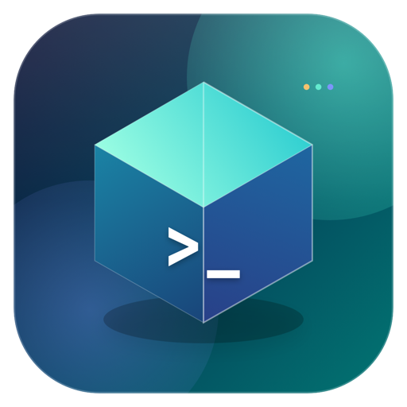
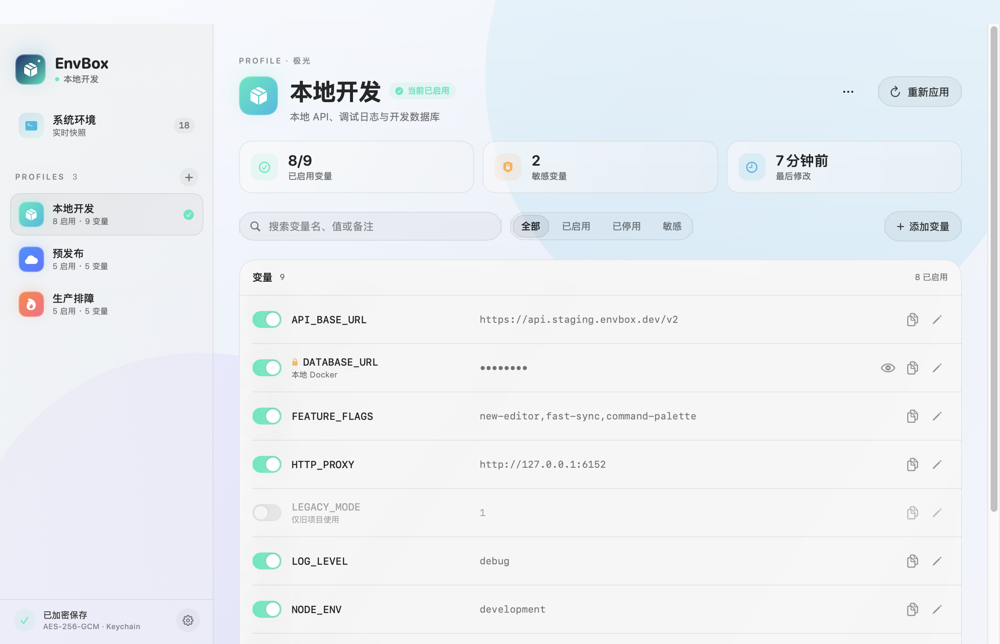
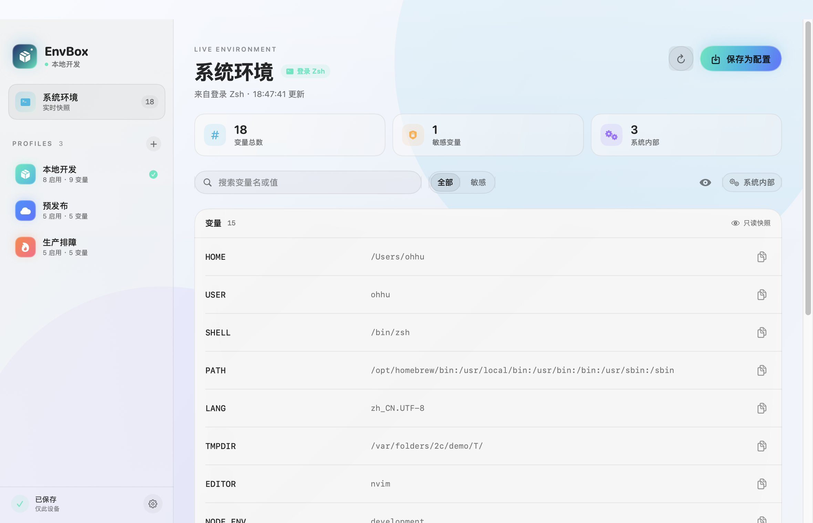
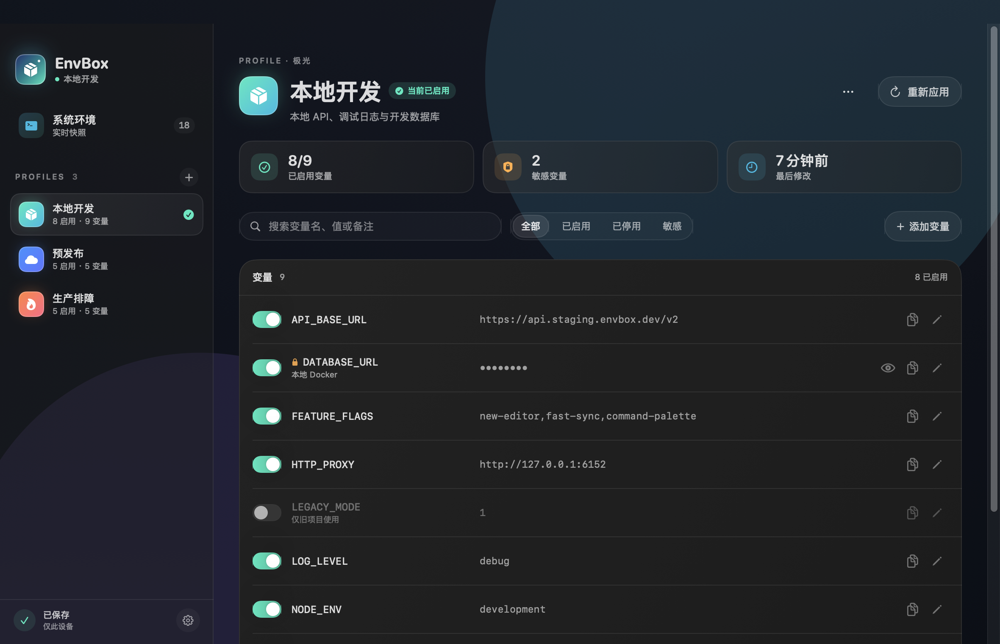
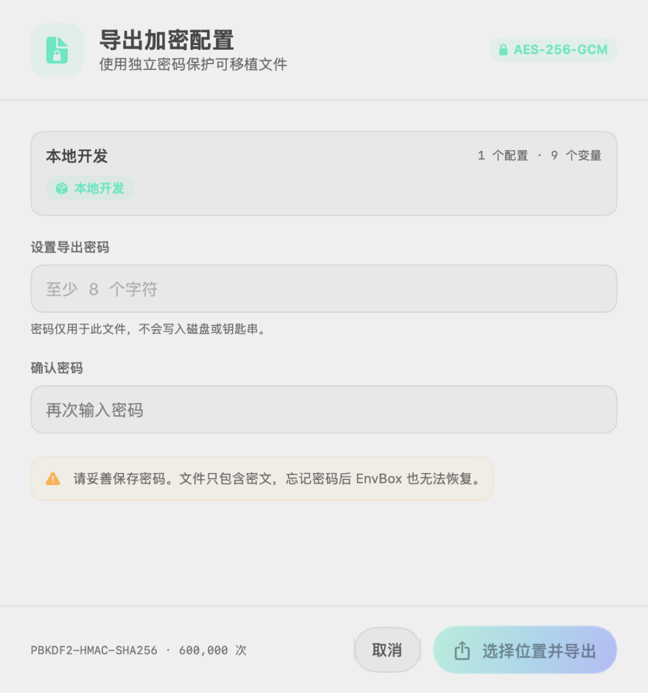

# EnvBox

**EnvBox** 是一个原生 macOS 环境变量管理器。它读取真实的登录 Shell 环境（Zsh / Bash），让你把变量整理成多个可加密保存的配置，并在菜单栏或主窗口中快速切换。

<p align="center">
  
</p>

<p align="center">
  
</p>

## 功能

- **实时系统环境**：读取 App 进程与登录 Shell 环境，显示变量来源与敏感标记。
- **可编辑配置**：变量名、值、启用状态、敏感标记和备注均可编辑，支持搜索与筛选。
- **加密配置库**：本地配置库使用 AES-256-GCM 加密，256 位随机密钥存入 macOS Keychain，磁盘上只有密文。
- **配置快速切换**：主窗口一键应用，菜单栏常驻图标可快速切换不同配置。
- **常驻通知区域（Windows）**：托盘图标列出全部配置，勾选标记当前生效项，可停用或退出；关闭窗口只是收起，再次启动会把已有窗口唤回。
- **加密导入导出**：使用独立密码保护的可移植 `.envbox` 文件。
- **macOS 原生体验**：SwiftUI、原生材质、跟随系统明暗外观、减少动态效果支持、键盘快捷键。
- **隐私优先**：macOS 版不联网，Windows 版默认每天检查一次更新（只访问 GitHub Releases），可完全关闭；无遥测、无第三方 SDK；敏感值默认遮盖；敏感剪贴板 45 秒自动清除（仅 macOS）。
- **正式版本自动发布**：GitHub Actions 仅在严格 `vMAJOR.MINOR.PATCH` 标签上发布 macOS arm64 与 Windows x64 安装包。

<details>
<summary><strong>更多界面截图：系统环境 / 暗色模式 / 加密导出</strong></summary>

<br>

**系统环境快照**



**暗色模式**



**加密导出**

<p align="center">
  
</p>

</details>

## 系统要求

- macOS 14 Sonoma 或更高版本
- Apple Silicon Mac（arm64）
- 从源码构建需要 Xcode 16+ 或 Swift 6 toolchain（测试使用 Swift Testing）
- Windows（可选）：Windows 10 1809 或更高，x64；详见 [Windows 版说明](docs/WINDOWS-PORT.md)

## 安装

从 [Releases](https://github.com/Ohhu/EnvBox/releases) 下载最新 `EnvBox-x.y.z-macOS-arm64.dmg`，拖入 Applications 即可。

如果首次启动被系统拦截，请在 Finder 中右键 App 并选择“打开”。
Windows 版是独立的 Go + Wails 实现，分发形态为安装器：下载 `EnvBox-<version>-Windows-amd64-Setup.exe`，装到 `%LOCALAPPDATA%\Programs\EnvBox`（无需管理员）。命令行与 MCP 位于 `%LOCALAPPDATA%\Programs\EnvBox\bin\envbox.exe`；自更新走 GitHub Releases：默认每天检查一次，可在设置里完全关闭。构建与发布见 [docs/WINDOWS-BUILD-RELEASE.md](docs/WINDOWS-BUILD-RELEASE.md)。

## 使用

### 读取环境

首次启动会读取当前进程环境，并额外启动一次非交互式登录 Shell（优先使用 `$SHELL` 中的 Zsh/Bash，否则回退到 `/bin/zsh`）读取 `.zprofile`、`.zshrc` 或 `.bash_profile` 中导出的变量。读取失败时会回退到进程环境，并在界面提示。

读取登录 Shell 会执行你自己的 Shell 启动文件。EnvBox 只读取 `env` 输出，不会执行或求值环境变量内容。若你不想运行启动文件，可在设置中关闭“读取登录 Shell 环境”。

### 创建与编辑配置

在系统环境页面点击“保存为配置”，或在侧边栏点击 `+` 创建空配置。变量支持启停、敏感标记、备注和搜索。所有修改自动加密保存。

### 应用配置

点击“应用到此 Mac”后，EnvBox 会：

1. 把启用的变量写入当前用户的系统环境；
2. 清理上一个配置写入、但新配置不再包含的变量；
3. 如果已启用 Shell 集成，生成 `~/.envbox/active.zsh`（权限 `0600`），供登录 Shell 加载。

已经运行的终端和 App 不会改变。新启动的 App 会读取新的系统环境；新开的 Zsh 终端需要在设置中启用一次 Shell 集成，EnvBox 会向 `~/.zshrc` 写入带标记的受管理片段：

```zsh
# >>> EnvBox shell integration >>>
if [ -f "$HOME/.envbox/active.zsh" ]; then
  source "$HOME/.envbox/active.zsh"
fi
# <<< EnvBox shell integration <<<
```

移除集成会删除该 `.zshrc` 片段和明文 `~/.envbox/active.zsh`，但不会清除已应用的系统环境变量；重新启用集成时会根据当前配置重建激活脚本。修改 `.zshrc` 前会备份到 `~/.envbox/backups/`（最多保留 5 份），若受管理标记不完整则拒绝写入。

### MCP

设置 → MCP 打开开关后，客户端可用 `EnvBox.app/Contents/Helpers/envbox` 作为 MCP 服务器（stdio）：

| 工具 | 作用 |
| --- | --- |
| `env_describe` | 变量名、长度、指纹、代际 |
| `env_exec` | 在最新配置环境中执行命令，变量在子进程内展开 |
| `env_reveal` | 返回明文；默认关闭 |

设置页切换客户端后可分别复制 JSON 或提示词。命令行等价物：

```bash
envbox mcp
envbox describe BAIDU_COOKIES
envbox exec -- curl -H "Cookie: $BAIDU_COOKIES" https://example.com
envbox reveal-policy --allow
```

### 导入与导出

- 导出时可选择单个配置或全部配置，必须设置至少 8 个字符的密码。
- 文件只包含密文；密码不会保存，丢失后无法恢复。
- 导入只新增配置，不覆盖现有配置；同名配置自动重命名（macOS 导入会重命名；Windows 的 `envbox import` 会先按配置名与 ID 预检，冲突时提示具体是哪一条）。
- 导入文件有大小、配置数量和变量数量上限，防止畸形文件耗尽资源。

## 安全模型

| 数据 | 保护方式 |
| --- | --- |
| 本地配置库 | AES-256-GCM；随机 256 位密钥，macOS 存登录 Keychain、Windows 由 DPAPI 保护（见 [SECURITY.md](SECURITY.md)）；macOS 权限 `0600`，Windows 由配置目录 ACL 保护 |
| 导出文件 | PBKDF2-HMAC-SHA256（600,000 次）+ AES-256-GCM；独立密码 |
| 敏感值展示 | 默认遮盖，可逐项显示；macOS 复制后标记 `org.nspasteboard.ConcealedType` 并可 45 秒自动清空剪贴板（Windows 尚未实现） |
| Shell 激活文件 | 内容为明文（Shell 必须能读取）；macOS 权限 `0600`，Windows 由配置目录 ACL 保护 |
| 网络 | macOS 构建不含任何网络代码或第三方 SDK；Windows 构建默认每天检查一次更新（只访问 GitHub Releases），可完全关闭 |

完整威胁模型与已知边界见 [SECURITY.md](SECURITY.md)。

## 从源码构建

```bash
git clone https://github.com/Ohhu/EnvBox.git
cd EnvBox

# 单元测试
swift test

# 构建当前架构的 .app（开发用）
./Scripts/macos/build-app.sh
open dist/EnvBox.app

# arm64 + DMG + ZIP
VERSION=1.1.1 ./Scripts/macos/build-app.sh
VERSION=1.1.1 ./Scripts/macos/package-release.sh
```

脚本默认使用 PATH 中的 `swift`。如需指定工具链：

```bash
SWIFT_BIN=/path/to/swift ./Scripts/macos/build-app.sh
```

## 发布

仅严格 `vMAJOR.MINOR.PATCH` 标签会触发构建；其他标签只运行 gate，不编译。

```bash
# VERSION 必须与标签一致
echo 1.1.1 > VERSION
git add VERSION
git commit -m "Release 1.1.1"
git tag v1.1.1
git push origin main --tags
```

详细发布流程与 macOS 签名凭据见 [docs/RELEASE.md](docs/RELEASE.md)；Windows 见 [docs/WINDOWS-BUILD-RELEASE.md](docs/WINDOWS-BUILD-RELEASE.md) 的「签名」一节。

## 项目结构

目录按“这段代码属于谁”划分：`shared/` 两端共用，`cmd/` 只放宿主，`internal/core` 是与界面无关的引擎，`internal/windows` 是 Windows 实现。macOS 沿用 SwiftPM 的默认根，Windows 沿用 Go 模块根。

```text
shared/                   两端共用，任何一方都不拥有
  ui/assets/              界面单源：index.html、app.js、app.css、tokens.css、图标
  ui/embed.go             把同一批文件嵌进 Windows 可执行文件
  design/tokens.json      颜色、圆角、间距、字号、动效的唯一来源
internal/core/            引擎：model、cryptox、portable、apperr、buildinfo
internal/windows/         Windows 实现：注册表、配置库、PowerShell、MCP、更新
cmd/windows/envbox/       GUI 宿主（Wails v3，/api/state 与 /api/dispatch）
cmd/windows/envbox-cli/   CLI 与 MCP stdio server
Sources/EnvBox*/          macOS 宿主（SwiftUI，含 WebUI 容器）
Resources/                图标、Info.plist、权限声明
build/windows/            图标、清单、版本资源模板
installer/windows/        Inno Setup 脚本
Scripts/macos/            构建、签名、公证
Scripts/windows/          构建、打包、签名
Scripts/shared/           tokens 生成、无宿主预览
docs/                     发布流程、移植记录、界面单源说明
```

平台归属与改动纪律见 [docs/ARCHITECTURE.md](docs/ARCHITECTURE.md)。`.github/workflows/` 下有两个发布工作流：`release.yml`（macOS）与 `release-windows.yml`（Windows），共用同一个 GitHub Release。

## 许可证

[MIT](LICENSE) © 2026 Ohhu
